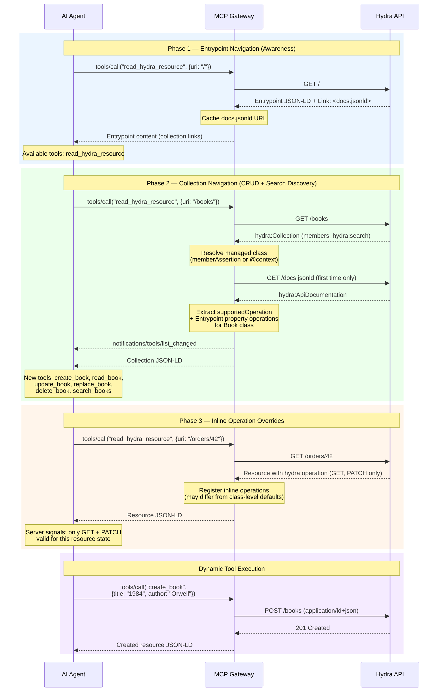
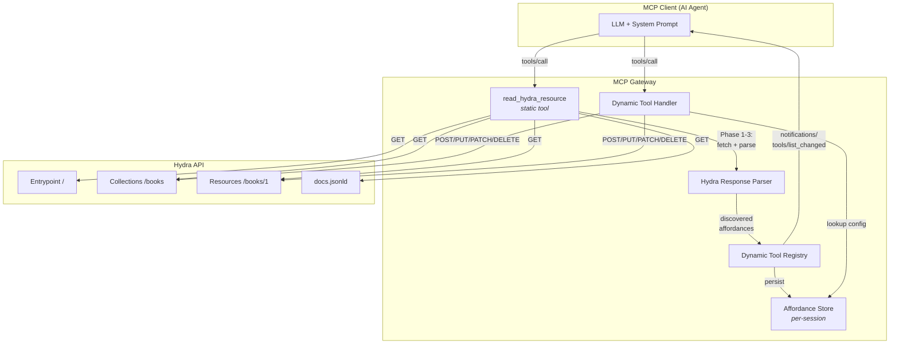

# Architecture Diagram (Mermaid)

Convert to TikZ/PDF for inclusion in the paper. Use `mmdc` (mermaid-cli) to render:
```bash
mmdc -i diagram.md -o diagram.pdf -t neutral
```

## Sequence Diagram: Three-Phase Discovery



## Component Diagram


